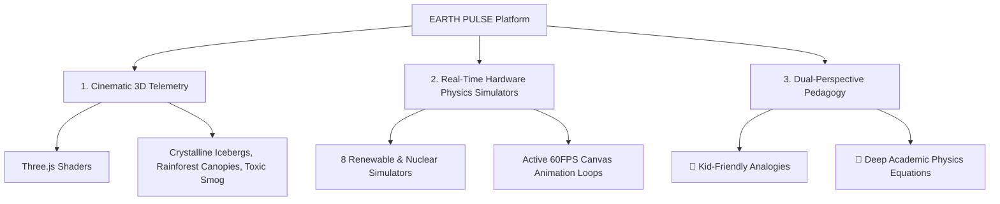
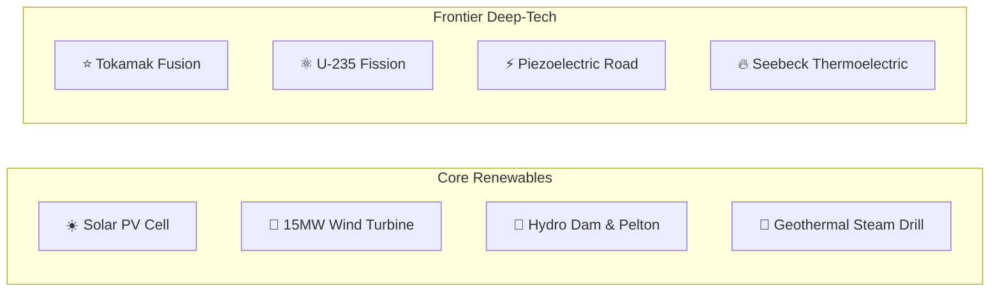

# 🌍 EARTH PULSE — Planetary Telemetry & Clean Energy Lab

[](https://react.dev/)
[](https://www.typescriptlang.org/)
[](https://vitejs.dev/)
[](https://tailwindcss.com/)
[](https://threejs.org/)
[](https://stitch.withgoogle.com/)
[](#)

> **"From quantum electron excitation in solar cells to 800,000-year Antarctic ice core bubbles, experience the living physics of our planet through cinematic 3D WebGL scenes, verified empirical telemetry, and interactive visual hardware simulators that both cutting-edge researchers and 10-year-old children can intuitively explore."**

---

## 🏛️ Utopian Clean Energy Civilization (3D Vision)


*Figure 1: Concept art visualization of an interconnected zero-carbon maritime civilization powered by offshore 15MW wind turbines, crystalline hydro dams, deep geothermal magma drills, and tokamak fusion.*

---

## 📑 Comprehensive Table of Contents
1. [🌟 Executive Overview & Mission](#-executive-overview--mission)
2. [🖼️ Complete Visual Showcase (All 11 Stitch Screens)](#️-complete-visual-showcase-all-11-stitch-screens)
3. [🌐 Planetary Command Center (`Home.tsx`)](#-planetary-command-center-homettsx)
   - [The 4 Environmental Modes & 3D Shaders](#the-4-environmental-modes--3d-shaders)
   - [The 9 Planetary Boundaries (Science 2023)](#the-9-planetary-boundaries-richardson-et-al-science-2023)
   - [Planetary Carbon Mass Conservation Equation & The Giant Bathtub](#planetary-carbon-mass-conservation-equation--the-giant-bathtub)
   - [Planetary Feedback Loops Explained](#planetary-feedback-loops-explained)
4. [⚡ Interactive Clean Energy Simulators (`Solutions.tsx`)](#-interactive-clean-energy-simulators-solutionstsx)
   - [☀️ 1. Solar Photovoltaic (PV) Quantum Cell](#1--solar-photovoltaic-pv-quantum-cell)
   - [💨 2. 15MW Aerodynamic Offshore Wind Turbine](#2--15mw-aerodynamic-offshore-wind-turbine)
   - [🌊 3. Hydroelectric Dam & Pelton Runner](#3--hydroelectric-dam--pelton-runner)
   - [🌋 4. Geothermal Deep Magma Steam Drill](#4--geothermal-deep-magma-steam-drill)
   - [⭐ 5. Tokamak Thermonuclear Fusion Reactor](#5--tokamak-thermonuclear-fusion-reactor)
   - [⚛️ 6. Controlled Uranium-235 Nuclear Fission](#6--controlled-uranium-235-nuclear-fission)
   - [⚡ 7. Piezoelectric Kinetic Roadway Harvester](#7--piezoelectric-kinetic-roadway-harvester)
   - [🔥 8. Thermoelectric Seebeck / Peltier Harvester](#8--thermoelectric-seebeck--peltier-harvester)
   - [Quick Preset Configurations & LCOE Economics](#quick-preset-configurations--lcoe-economics)
5. [🎮 Visual Simulation Lab (`SimulationLab.tsx`)](#-visual-simulation-lab-simulationlabtsx)
   - [🌊 Coastal Sea-Level Flood Machine & The Melting Soda Glass](#-coastal-sea-level-flood-machine--the-melting-soda-glass)
   - [🌲 Rainforest Tree Machine & Earth's Super-Lungs](#-rainforest-tree-machine--earths-super-lungs)
   - [☀️ Smog-to-Sunshine Machine & The Sky Sweeper](#️-smog-to-sunshine-machine--the-sky-sweeper)
6. [📈 800,000-Year Climate Data Explorer (`DataExplorer.tsx`)](#-800000-year-climate-data-explorer-dataexplorertsx)
   - [EPICA Dome C Ice Cores vs Modern Anthropocene](#epica-dome-c-ice-cores-vs-modern-anthropocene)
   - [IPCC AR6 Radiative Forcing Breakdown](#ipcc-ar6-radiative-forcing-breakdown)
   - [Keeling Curve & NASA GISTEMP Integration](#keeling-curve--nasa-gistemp-integration)
7. [🛢️ Global Pollution & Radiation Hub (`PollutionHub.tsx`)](#️-global-pollution--radiation-hub-pollutionhubtsx)
   - [Pelagic Ocean Gyres & Microplastic Photodegradation](#pelagic-ocean-gyres--microplastic-photodegradation)
   - [Safecast Global Radiation Monitoring Grid](#safecast-global-radiation-monitoring-grid)
   - [Coal Fleet Flue-Gas Desulfurization (FGD) Scrubbers](#coal-fleet-flue-gas-desulfurization-fgd-scrubbers)
8. [🛰️ Decadal Satellite Comparative Gallery (`Gallery.tsx`)](#️-decadal-satellite-comparative-gallery-gallerytsx)
   - [Glacier Bay, Aral Sea & Amazon Deforestation](#glacier-bay-aral-sea--amazon-deforestation)
   - [Multi-Spectral Band Processing (NDVI & InSAR)](#multi-spectral-band-processing-ndvi--insar)
9. [🔬 Mathematical Physics & Academic Citations (`About.tsx`)](#-mathematical-physics--academic-citations-abouttsx)
10. [🎨 UI/UX Design System & Theme Engine](#-uiux-design-system--theme-engine)
11. [🚀 Quickstart & Installation](#-quickstart--installation)
12. [📁 Complete File & Folder Architecture](#-complete-file--folder-architecture)

---

## 🌟 Executive Overview & Mission

**EARTH PULSE** was developed for the **MDDC Hackathon** to revolutionize environmental communication and clean energy education. Climate dashboards frequently suffer from one of two fatal flaws: they are either too dry and text-heavy for non-scientists, or too superficial to provide genuine academic or engineering value. 

EARTH PULSE solves this through a **Tri-Pillar Design Philosophy**:



1. **Cinematic 3D WebGL Environments**: Custom Three.js shaders rendering crystalline Arctic icebergs, humid bioluminescent tropical rainforest canopies, toxic charcoal smog atmospheres, and utopian oceanic clean energy micro-islands.
2. **Interactive Hardware Physics Simulators**: 8 real-time canvas simulations with dynamic sliders allowing users to manipulate solar irradiance, blade pitch angles, hydro penstock valves, geothermal boreholes, tokamak magnetic fields, and nuclear control rods.
3. **Dual-Perspective Pedagogy**: Every simulator and data metric includes a dedicated **"🧒 Simple Words & Kid-Friendly Analogy"** mode alongside the rigorous **"🔬 Deep Science & Telemetry"** mode.
4. **Empirical Scientific Telemetry**: Peer-reviewed equations and datasets from NASA GISTEMP, NOAA GML, EPICA Dome C ice cores, IPCC AR6, the Global Carbon Project (2024), and the Stockholm Resilience Centre.

---

## 🖼️ Complete Visual Showcase (All 11 Stitch Screens)

The visual identity of EARTH PULSE was conceived and generated using **Stitch MCP**, utilizing high-precision liquid glassmorphism, responsive cyber-oceanic HUD telemetry, and tailored chromatic lighting.

### Screen 1: Modern Clean Energy Simulators Dashboard
*Stitch Screen ID: `ced63739d1cb4df19f8a76641f272f7b`*

*The primary interactive mission control center for renewable hardware and planetary decarbonization.*

---

### Screen 2: Solutions: The Future is Clean Dashboard
*Stitch Screen ID: `30e14238024a4d84be1a7ab19e07f208`*

*Planetary energy mix sandbox, levelized cost of energy (LCOE) gauges, and technology readiness levels (TRL).*

---

### Screen 3: Utopian Clean Energy Micro-Island (3D Concept)

*Concept art rendering of an interconnected zero-emission civilization powered by offshore wind, crystalline hydro dams, solar arrays, and clean fusion reactors.*

---

### Screen 4 & 5: Arctic Glaciers Mode & 3D Volumetric Iceberg
*Stitch Screen IDs: `7714af4fa9d14b77b90d602bb96a0fe3`*
| Arctic Glacier Dashboard View | 3D Volumetric Iceberg Render |
| :---: | :---: |
|  |  |
*Deep arctic navy (`#04111F`) with glacier cyan (`#6EE7F9`) reflections, thermodynamic ice-albedo telemetry, and cryospheric mass loss metrics.*

---

### Screen 6 & 7: Tropical Deforestation Mode & Rainforest Canopy
*Stitch Screen IDs: `7211fb67629b47b2802a8e2b8dfda8a0`*
| Deforestation Dashboard View | 3D Rainforest Canopy Render |
| :---: | :---: |
|  |  |
*Lush abyssal emerald forest (`#07140C`) highlighting Amazon biotic moisture pumps ("flying rivers") and canopy density.*

---

### Screen 8 & 9: Carbon & Emissions Mode & Planetary Smog 3D
*Stitch Screen IDs: `cb9922bf51b34bd3ba6614c33a09ce7d`*
| Carbon Telemetry Dashboard | 3D Smog & Heat Bloom Earth |
| :---: | :---: |
|  |  |
*Charcoal obsidian (`#0B0B10`) with atmospheric greenhouse heat bloom (`#FFB020` & `#FF2E88`) tracking Keeling Curve concentrations.*

---

### Screen 10: 800,000-Year Scientific Data Explorer
*Stitch Screen ID: `09898f22acf547a5a7cabd992a8338d5`*

*Paleoclimate ice cores (800,000 years), IPCC radiative forcing ($W/m^2$), and interactive CSV data export.*

---

### Screen 11: Global Pollution & Radiation Hub
*Stitch Screen ID: `8c92b3fa9976478e9dc005b31f26b493`*

*Pelagic microplastic gyres, Safecast environmental radiation grids, and industrial flue-gas desulfurization scrubbers.*

---

## 🌐 Planetary Command Center (`Home.tsx`)

Located at [`src/pages/Home.tsx`](file:///home/vinaysingh/MDDC_hackthon/src/pages/Home.tsx), the Planetary Command Center serves as the portal into Earth's living telemetry.

### The 4 Environmental Modes & 3D Shaders

| Mode | Accent Palette | Procedural 3D WebGL Shader | Core Metric Tracked |
| :--- | :--- | :--- | :--- |
| **🧊 Arctic Glaciers** | `#6EE7F9` (Glacier Cyan) | Volumetric crystalline iceberg with depth refraction & floating bergy bits | Cryosphere mass loss ($-279\text{ Gt/yr}$) |
| **🌲 Deforestation** | `#22C55E` (Emerald Green) | Instanced tropical forest canopy with floating bioluminescent bio-aerosol spores | Primary forest loss ($-3.8\text{M ha/yr}$) |
| **🏭 Carbon Smog** | `#FFB020` (Smog Amber) | Murky smog atmosphere with pulsing red heat bloom & industrial particulate haze | Atmospheric $\text{CO}_2$ concentration ($424\text{ ppm}$) |
| **☀️ Solutions Lab** | `#38BDF8` & `#34D399` | Clean ocean horizon with offshore wind turbines & solar irradiance reflections | Global clean power share ($30.2\%$) |

---

### The 9 Planetary Boundaries (Richardson et al., *Science* 2023)

The dashboard renders the updated Stockholm Resilience Centre planetary boundaries framework, showing human transgression across the Earth system:

```
[BREACHED] 🔴 1. Climate Change (CO₂: 424 ppm vs 350 ppm safe limit)
[BREACHED] 🔴 2. Biosphere Integrity (Extinction rate >100 E/MSY vs <10 safe limit)
[BREACHED] 🔴 3. Biogeochemical Flows (Phosphorus: 22.6 Tg/yr vs 11 Tg/yr safe limit)
[BREACHED] 🔴 4. Land-System Change (Global forest cover <60% vs 75% safe limit)
[BREACHED] 🔴 5. Freshwater Change (Blue & green water cycle disruption)
[BREACHED] 🔴 6. Novel Entities (Synthetic plastics, PFAS, chemical contaminants)
[WARNING]  🟡 7. Ocean Acidification (Aragonite saturation Ω_arag = 2.80)
[SAFE]     🟢 8. Atmospheric Aerosol Loading (Regional optical depth within limits)
[SAFE]     🟢 9. Stratospheric Ozone Depletion (Montreal Protocol recovery trajectory)
```

---

### Planetary Carbon Mass Conservation Equation & The Giant Bathtub

$$\frac{dC_{\text{atm}}}{dt} = E_{\text{fossil}} (37.4\text{ Gt}) + E_{\text{land\_use}} (4.1\text{ Gt}) - S_{\text{ocean}} (10.5\text{ Gt}) - S_{\text{land}} (11.8\text{ Gt}) = +19.2\text{ Gt CO}_2\text{/year}$$

#### 🛁 The Giant Bathtub Analogy (Kid-Friendly)
> *"Imagine planet Earth's atmosphere is a giant porcelain bathtub. Burning coal, oil, and gas is like turning on a super-fast faucet blasting out **41.5 billion tons** of water every single year! Our natural oceans and forests are two small drains at the bottom, but together they can only swallow **22.3 billion tons** per year. Because the faucet is pouring in twice as fast as the drains can empty, the bathtub is overflowing with heat!"*

---

### Planetary Feedback Loops Explained

1. **Ice-Albedo Positive Feedback Loop**:
   - *Scientific Principle*: Sea ice reflects $\sim 85\%$ of incoming solar radiation back into space (albedo $\alpha \approx 0.85$). As ice melts into dark open ocean water, albedo drops to $\alpha \approx 0.06$. The dark ocean absorbs $94\%$ of the sun's heat, accelerating further ice melting.
   - *🧒 White vs. Black T-Shirt Analogy*: *"When you wear a dark black t-shirt on a hot summer afternoon, you feel boiling hot because black absorbs the sunlight. When you wear a crisp white t-shirt, it bounces the sunlight away and keeps you cool. Polar ice is Earth's white t-shirt! When it melts into dark blue water, Earth puts on a black t-shirt!"*
2. **Permafrost Methane Burp**:
   - *Scientific Principle*: Arctic tundra holds an estimated $1,400\text{ Gt}$ of organic carbon locked in perennially frozen soils. Thawing permafrost activates methanogenic archaea, releasing potent methane ($\text{CH}_4$), with a 28x higher 100-year Global Warming Potential than $\text{CO}_2$.
   - *🧒 The Freezer Door Analogy*: *"Leaving frozen meat inside a locked freezer keeps it safe forever. But if you unplug the freezer and leave the door open on a hot day, bacteria wakes up, rots the meat, and produces foul smelling gas! Arctic permafrost is Earth's giant freezer!"*
3. **Biotic Moisture Pump & Amazon Flying Rivers**:
   - *Scientific Principle*: Transpiration from billions of broadleaf Amazon trees pumps water vapor into the lower troposphere, generating low-pressure corridors that suck ocean trade winds inland, sustaining inland rainfall across South America.
   - *🧒 The Sky Fountain Analogy*: *"Every single big jungle tree drinks groundwater and sprays hundreds of gallons of invisible cool mist into the sky like a giant sky fountain! These mists bunch together into invisible flying rivers in the clouds that water farms thousands of miles away!"*

---

## ⚡ Interactive Clean Energy Simulators (`Solutions.tsx`)

Located in [`src/pages/Solutions.tsx`](file:///home/vinaysingh/MDDC_hackthon/src/pages/Solutions.tsx), the Clean Energy Lab features **8 fully animated, interactive physics-based simulators** running at 60 FPS:



---

### 1. ☀️ Solar Photovoltaic (PV) Quantum Cell
- **Visual Canvas Dynamics**: The sun radiates golden photon packets across vacuum space that strike an anti-reflective texturized silicon wafer. When absorbed, energized electrons ($e^-$) separate at the P-N junction, traveling through an animated circuit wire to illuminate a filament lightbulb and light up suburban houses.
- **Interactive Controls**:
  - `Sunlight Irradiance Slider`: $0$ to $1,200\text{ W/m}^2$ (Night $\rightarrow$ Sahara Desert Noon)
  - `Cloud Coverage Slider`: $0\%$ to $100\%$ (Clear skies $\rightarrow$ Heavy overcast storm)
  - `Array Tilt Angle`: $0^\circ$ to $90^\circ$ (Adjusts cosine incident angle $\cos\theta$)
- **🧒 Kid-Friendly Explanation**:
  > *"Think of billiard balls! Sunlight is made of billions of tiny, super-fast bouncing balls called photons. When they crash into sleepy electrons resting inside the silicon sand-crystal, they knock them down a wire slide! That river of electrons turns on your bedroom lights!"*
- **🔬 Deep Quantum Formula**:
  $$J_{sc} = q \int_{\lambda=0}^{\lambda_g} \Phi(\lambda) [1 - R(\lambda)] IQE(\lambda) \, d\lambda \quad \left(E_g = 1.34\text{ eV}, \; \eta_{\text{Shockley-Queisser}} \le 33.7\%\right)$$

---

### 2. 💨 15MW Aerodynamic Offshore Wind Turbine
- **Visual Canvas Dynamics**: Direct-drive offshore wind turbine equipped with 3 curved airfoil blades spinning at variable RPM proportional to wind speed. Animated cyan wind streamlines curve over blade contours, showing aerodynamic lift. Nacelle cutaway displays spinning internal generator coils sending green power pulses down the mast into subsea HVDC cables. Automatic storm shutoff ($> 25\text{ m/s}$) feathing blades to protect internal bearings.
- **Interactive Controls**:
  - `Wind Velocity`: $0$ to $30\text{ m/s}$ ($0$ calm, $12\text{ m/s}$ rated peak, $25+\text{ m/s}$ storm cut-off)
  - `Blade Pitch Angle`: $0^\circ$ to $45^\circ$ (Max torque $\rightarrow$ Storm braking)
- **🧒 Kid-Friendly Explanation**:
  > *"Like blowing on a giant pinwheel! The invisible push of ocean wind hugs curved airplane wings, lifting them to spin round and round. Inside the top box, the blades spin a huge magnet wrapped in copper wires to capture lightning on a leash!"*
- **🔬 Fluid Dynamics Formula**:
  $$P_{\text{mech}} = \frac{1}{2} \rho \pi R^2 v^3 C_p \quad \left(C_{p,\text{max}} = \frac{16}{27} \approx 59.3\% \text{ Betz Limit}\right)$$

---

### 3. 🌊 Hydroelectric Dam & Pelton Runner
- **Visual Canvas Dynamics**: Cross-section of a mountain reservoir holding high-elevation blue water behind a concrete gravity dam. Slanted penstock intake tube carries accelerated water downward into the turbine powerhouse. High-velocity water jets spray against a spinning Pelton waterwheel bucket runner, generating realistic water droplet mist and feeding high-voltage transmission lines.
- **Interactive Controls**:
  - `Penstock Gate Valve`: $0\%$ to $100\%$ ($0$ to $1,500\text{ m}^3\text{/s}$ flow)
  - `Reservoir Head Height`: $50\text{m}$ to $250\text{m}$ (Elevation drop)
- **🧒 Kid-Friendly Explanation**:
  > *"Like a giant waterpark slide powering an entire city! Water held high up in the lake is heavy. When we open the pipe gate, gravity pulls the water down super fast, blasting against spinning metal spoons with unstoppable force!"*
- **🔬 Hydrokinetic Formula**:
  $$P = \eta \cdot \rho \cdot g \cdot Q \cdot H \quad (v = \sqrt{2gH} \implies \text{Jet Velocity: } 59.4\text{ m/s at 180m})$$

---

### 4. 🌋 Geothermal Deep Magma Steam Drill
- **Visual Canvas Dynamics**: Subterranean Earth cross-section displaying surface cooling towers, hard granite rock strata, and an active glowing red/orange magma chamber at the bottom. Blue injection borehole pumps cold water deep underground into fractured volcanic rock. Superheated water boils under extreme pressure and roars up the orange production well as pressurized steam, driving high-speed Rankine turbines before condensing into gentle white cooling plumes.
- **Interactive Controls**:
  - `Borehole Drilling Depth`: $1.0\text{ km}$ to $5.0\text{ km}$ (Supercritical crust)
  - `Subsurface Magma Heat`: $120^\circ\text{C}$ to $450^\circ\text{C}$ (Volcanic pluton temperature)
- **🧒 Kid-Friendly Explanation**:
  > *"Earth's giant teapot! The center of our planet is like a boiling soup pot. We drill a deep tube, squirt water down, and the hot rocks instantly flash it into whistling steam that spins our fans day and night, even during winter blizzards!"*
- **🔬 Thermodynamic Formula**:
  $$\dot{W}_{\text{turbine}} = \dot{m} \cdot (h_{\text{in}} - h_{\text{out}}) \cdot \eta_{\text{isentropic}} \quad (\text{Enthalpy: } 2,800\text{ kJ/kg})$$

---

### 5. ⭐ Tokamak Thermonuclear Fusion Reactor
- **Visual Canvas Dynamics**: Deuterium-Tritium plasma ions ($^2\text{H}$ and $^3\text{H}$) swirling inside a 12-Tesla magnetic confinement torus at $150\text{ Million }^\circ\text{C}$. Calculates the Lawson triple product and fusion gain factor ($Q > 1.0$).
- **Interactive Controls**:
  - `Toroidal Magnetic Field`: $4.0\text{ T}$ to $14.0\text{ T}$ (Superconducting coils)
  - `Plasma Core Temperature`: $20\text{M}^\circ\text{C}$ to $250\text{M}^\circ\text{C}$ (Neutral beam & RF heating)
- **🧒 Kid-Friendly Explanation**:
  > *"We are building a miniature star inside a magnetic bottle right here on Earth! Two tiny hydrogen atoms from ocean water hug so tightly they merge into helium, releasing enormous star-power with zero pollution!"*
- **🔬 Plasma Physics Formula**:
  $$n \cdot T \cdot \tau_E \ge 3 \times 10^{21}\text{ keV}\cdot\text{s/m}^3 \quad \left(^2\text{H} + {}^3\text{H} \rightarrow {}^4\text{He} (3.5\text{ MeV}) + n (14.1\text{ MeV})\right)$$

---

### 6. ⚛️ Controlled Uranium-235 Nuclear Fission
- **Visual Canvas Dynamics**: Uranium fuel pin grid emitting prompt neutrons. Cadmium/boron control rods lower or raise into the core to moderate neutron capture and balance reactivity at critical $k_{\text{eff}} = 1.000$.
- **Interactive Controls**:
  - `Control Rod Depth`: $0\%$ (Supercritical) to $100\%$ (Full SCRAM shutdown)
  - `Coolant Flow Rate`: $20\%$ to $100\%$ (Pressurized light water loop)
- **🧒 Kid-Friendly Explanation**:
  > *"Like bowling! A tiny flying ball hits a big uranium atom, splitting it in two and shooting out heat plus two new mini balls. The black control rods are sponges we slide in to catch the extra balls so it never gets too hot!"*
- **🔬 Nuclear Physics Formula**:
  $$k_{\text{eff}} = \frac{\text{Neutrons produced in generation } n}{\text{Neutrons absorbed in generation } n-1} = 1.000 \quad \left(^{235}\text{U} + n \rightarrow \text{Fission Fragments} + 2.43 n + 200\text{ MeV}\right)$$

---

### 7. ⚡ Piezoelectric Kinetic Roadway Harvester
- **Visual Canvas Dynamics**: Dynamic crystal compression meter simulating heavy truck axle loads over embedded Lead Zirconate Titanate (PZT) ceramic pavement tiles to generate instantaneous DC displacement voltage.
- **Interactive Controls**:
  - `Vehicle Axle Load`: $1.0\text{ Ton}$ (Sedan) to $40.0\text{ Tons}$ (Semi-Truck)
  - `Traffic Flow Frequency`: $10$ to $120\text{ vehicles/min}$
- **🧒 Kid-Friendly Explanation**:
  > *"Magic crystals under the road! Just like squeezing a wet sponge makes water squirt out, squeezing special crystals under the street when heavy cars drive over them squeezes out clean electricity!"*
- **🔬 Solid-State Formula**:
  $$D = d \cdot \sigma + \varepsilon^T E \quad \left(V = \frac{d_{33} \cdot F \cdot h}{\varepsilon_r \varepsilon_0 A}\right)$$

---

### 8. 🔥 Thermoelectric Seebeck / Peltier Harvester
- **Visual Canvas Dynamics**: Industrial exhaust heat engine measuring the temperature differential ($\Delta T$) between a hot factory smelter ($280^\circ\text{C}$) and cool ambient air ($25^\circ\text{C}$) across $\text{Bi}_2\text{Te}_3$ semiconductor couples.
- **Interactive Controls**:
  - `Industrial Exhaust Temp`: $80^\circ\text{C}$ to $450^\circ\text{C}$
  - `Cooling Sink Temp`: $5^\circ\text{C}$ to $35^\circ\text{C}$
- **🧒 Kid-Friendly Explanation**:
  > *"Hot and cold make power! If you put one side of a special chip near a campfire and the other side on ice, electrons hate being hot and stampede to the cold side, creating free electricity from wasted factory smoke!"*
- **🔬 Thermoelectric Formula**:
  $$V_{\text{Seebeck}} = -S \cdot \Delta T \quad \left(ZT = \frac{S^2 \sigma}{\kappa} T \approx 1.2\right)$$

---

### Quick Preset Configurations & LCOE Economics

The Solutions page includes instant hardware presets:
- ☀️ **"Max Sun"**: Sets irradiance to $1,050\text{ W/m}^2$, $0\%$ clouds, $34^\circ$ tilt $\rightarrow$ **$480\text{ kW}$ Array Output**.
- 💨 **"Storm Gale"**: Sets wind to $18\text{ m/s}$, pitch to $8^\circ$ $\rightarrow$ **$15.0\text{ MW}$ Peak Turbine Output**.
- 🌊 **"High Runoff"**: Sets penstock valve to $95\%$, head height to $220\text{m}$ $\rightarrow$ **$2.68\text{ GW}$ Dam Output**.
- 🌋 **"Magma Boost"**: Sets borehole depth to $4.8\text{km}$, pluton heat to $410^\circ\text{C}$ $\rightarrow$ **$142\text{ MW}$ Geothermal Output**.

---

## 🎮 Visual Simulation Lab (`SimulationLab.tsx`)

Located at [`src/pages/SimulationLab.tsx`](file:///home/vinaysingh/MDDC_hackthon/src/pages/SimulationLab.tsx), this laboratory features animated interactive machines specifically designed so that **children and students can see direct cause and effect in real time**:

```
+-----------------------------------------------------------------------------------------+
|                                VISUAL SIMULATION LAB                                     |
|  [🌊 Coastal Flood Machine]     [🌲 Rainforest Tree Machine]    [☀️ Smog Sweeper Machine] |
|   Glacier drops, fish, beach     Chainsaw vs tree saplings,      Smokestacks vs turbines, |
|   umbrella, bungalow, seawall    butterflies, forest canopy      clouds clear to smiling sun
+-----------------------------------------------------------------------------------------+
```

### 🌊 Coastal Sea-Level Flood Machine & The Melting Soda Glass
- **Visual Canvas Mechanics**:
  - On the left, an icy blue glacier sits on polar bedrock, dripping physical water drops.
  - In the center ocean, cute fish swim peacefully back and forth.
  - On the right coast, a sandy beach features a sun umbrella and a cozy vacation bungalow, protected by a reinforced downtown seawall.
- **Interactive Cause & Effect**:
  - At $+1.0^\circ\text{C}$, the beach is sunny and children can play on the sand.
  - At $+2.0^\circ\text{C}$, the water level rises to submerge the umbrella and beachfront porch.
  - At $+3.5^\circ\text{C}+$, the seawall is overwhelmed! Water floods downtown skyscrapers and warning alarms flash.
- **🥤 The Melting Soda Glass Analogy**:
  > *"Imagine a glass already filled to the very top with bubbly soda. If you dump a handful of big ice cubes into it, what happens? Soda spills all over your table! That's what happens when gigantic polar ice shelves melt into our oceans—coastal cities get flooded!"*

---

### 🌲 Rainforest Tree Machine & Earth's Super-Lungs
- **Visual Canvas Mechanics**:
  - Green rolling hills populated with swaying tropical trees, chirping birds, and fluttering yellow butterflies.
- **Interactive Cause & Effect**:
  - Increasing the **"Tree Chopping (Logging)"** slider summons chainsaws that fell trees into brown stumps with puffs of grey smoke, causing the birds and butterflies to flee.
  - Increasing the **"Tree Planting"** slider sprouts bright green baby saplings with magical sparkles, restoring the canopy and bringing the animals back.
- **🫁 Earth's Super-Lungs Analogy**:
  > *"Trees are Earth's magical super-lungs! When cars and factories puff out dirty carbon smoke, trees inhale that dirty air like a giant vacuum cleaner and breathe out sweet, fresh oxygen for us to play outside!"*

---

### ☀️ Smog-to-Sunshine Machine & The Sky Sweeper
- **Visual Canvas Mechanics**:
  - Industrial factory smokestacks blowing thick, murky grey/brown smog clouds into the sky.
- **Interactive Cause & Effect**:
  - At low clean energy, the sky is dark and hazy, obscuring the sun.
  - As the user slides **"Clean Renewable Energy"** up to $100\%$, modern spinning wind turbines and glistening blue solar panels appear on the green grass.
  - The smog clouds evaporate away, revealing a beaming, smiling golden sun with radiant sunbeams and crisp azure skies!
- **🧹 The Sky Sweeper Analogy**:
  > *"Dirty smog is like a dusty, muddy blanket covering the sky that makes everyone cough. When we install clean wind turbines and shiny solar panels, we sweep away the dusty blanket so the warm sun can smile down on us!"*

---

## 📈 800,000-Year Climate Data Explorer (`DataExplorer.tsx`)


Located at [`src/pages/DataExplorer.tsx`](file:///home/vinaysingh/MDDC_hackthon/src/pages/DataExplorer.tsx), this telemetry center visualizes empirical paleoclimate data:

### EPICA Dome C Ice Cores vs Modern Anthropocene
- Drilled to a depth of **$3,260\text{ meters}$** in East Antarctica, EPICA ice cores trap pristine prehistoric air bubbles spanning 8 continuous glacial-interglacial cycles:
  - Natural pre-industrial $\text{CO}_2$ range across 800,000 years: **$180\text{ ppm}$ (Ice Ages) to $280\text{ ppm}$ (Warm Interglacials)**.
  - Modern Anthropocene concentration: **$424\text{ ppm}$ (2026 NOAA Mauna Loa)**.
  - Conclusion: Modern atmospheric carbon dioxide exceeds any natural baseline in human existence by over **$50\%$**.

### IPCC AR6 Radiative Forcing Breakdown
The net human perturbation to Earth's energy balance is **$\Delta F_{\text{total}} = +2.91\text{ W/m}^2$**:
- Atmospheric $\text{CO}_2$: $+2.16\text{ W/m}^2$
- Methane ($\text{CH}_4$): $+0.54\text{ W/m}^2$
- Halocarbons (CFCs & HFCs): $+0.41\text{ W/m}^2$
- Tropospheric Ozone ($\text{O}_3$): $+0.47\text{ W/m}^2$
- Aerosol Indirect Albedo Cooling: $-1.10\text{ W/m}^2$

---

## 🛢️ Global Pollution & Radiation Hub (`PollutionHub.tsx`)


Located at [`src/pages/PollutionHub.tsx`](file:///home/vinaysingh/MDDC_hackthon/src/pages/PollutionHub.tsx), this module tracks global non-greenhouse environmental hazards:

### Pelagic Ocean Gyres & Microplastic Photodegradation
- Tracks plastic accumulation across the 5 oceanic convergence zones:
  1. **North Pacific Gyre** (The Great Pacific Garbage Patch): $1.6\text{ Million km}^2$, $>79,000\text{ tonnes}$ of plastic debris.
  2. **South Pacific Gyre**: Expanding accumulation zone between South America and Oceania.
  3. **North Atlantic Gyre**: High density of consumer packaging fragments.
  4. **South Atlantic Gyre**: Marine fishing gear and microplastic beads.
  5. **Indian Ocean Gyre**: High river-input concentration from developing basins.
- **Photodegradation Timeline**: Polyethylene and polypropylene do not biodegrade; ultraviolet radiation cleaves polymer backbones into microscopic particles ($< 5\text{mm}$) that persist for over **450 years**, bioaccumulating up trophic levels into seafood.

---

### Safecast Global Radiation Monitoring Grid
- Real-time simulation of the citizen-science Safecast environmental sensor network:
  - **Chernobyl Exclusion Zone (Pripyat, Ukraine)**: $2.450\ \mu\text{Sv/h}$ (Hotspots in the Red Forest from buried Cesium-137 and Strontium-90).
  - **Fukushima Daiichi Coastal Zone**: $0.780\ \mu\text{Sv/h}$ (Remediated soil zones).
  - **Global Ambient Background (Tokyo, New York, London)**: $0.080 - 0.120\ \mu\text{Sv/h}$ (Harmless natural cosmic rays and radon).
- **🩻 Dental X-Ray Analogy**:
  > *"Radiation is all around us naturally! Normal background radiation is like getting a tiny fraction of a dental X-ray once a year. In high-radiation exclusion zones, it's like having the X-ray machine running non-stop!"*

---

### Coal Fleet Flue-Gas Desulfurization (FGD) Scrubbers
- How modern power plants remove acid-rain-causing sulfur dioxide ($\text{SO}_2$):
  - Flue gas is sprayed with a wet slurry of ground limestone ($\text{CaCO}_3$).
  - Chemical reaction: $\text{SO}_2 + \text{CaCO}_3 + \frac{1}{2}\text{O}_2 + 2\text{H}_2\text{O} \rightarrow \text{CaSO}_4 \cdot 2\text{H}_2\text{O} + \text{CO}_2$.
  - The resulting byproduct is **synthetic gypsum**, which is recycled into wallboard for housing construction!
- **🚿 The Smokestack Shower Analogy**:
  > *"Imagine an industrial smokestack taking a shower! Before dirty smoke escapes into the sky, it passes through a mist of chalky water that washes away $98\%$ of the acid particles and turns the captured dirt into clean drywall boards for houses!"*

---

## 🛰️ Decadal Satellite Comparative Gallery (`Gallery.tsx`)

Located at [`src/pages/Gallery.tsx`](file:///home/vinaysingh/MDDC_hackthon/src/pages/Gallery.tsx), the interactive satellite suite enables before-and-after split-slider comparisons:

1. **Muir Glacier Calving Retreat (Alaska, USA)**:
   - *1941 Historical Survey vs. 2024 Sentinel-2*: Complete loss of 200 vertical meters of solid ice; $12\text{ km}$ retreat out of the fjord.
2. **Aral Sea Desiccation (Kazakhstan / Uzbekistan)**:
   - *2000 NASA MODIS vs. 2024 Landsat 9*: $90\%$ evaporation of Earth's 4th largest inland lake into the toxic Aralkum Desert.
3. **Rondônia Fishbone Deforestation (Brazilian Amazon)**:
   - *1984 Landsat 5 vs. 2024 Landsat 9*: Progression of systematic fishbone logging roads cutting into primary tropical rainforest.

---

## 🔬 Mathematical Physics & Academic Citations (`About.tsx`)

The mathematical engine behind EARTH PULSE integrates standard physical laws:

1. **Arrhenius Greenhouse Radiative Forcing**:
   $$\Delta F = \alpha \cdot \ln\left(\frac{C}{C_0}\right) = 5.35 \cdot \ln\left(\frac{C}{280}\right) \quad (\text{W/m}^2)$$
2. **Stefan-Boltzmann Blackbody Radiation Law**:
   $$j^* = \varepsilon \cdot \sigma \cdot T^4 \quad \left(\sigma = 5.670374 \times 10^{-8}\text{ W/m}^2\text{K}^4\right)$$
3. **Thermosteric Ocean Thermal Expansion**:
   $$\frac{\Delta V}{V_0} = \int \beta(T, S, P) \cdot \Delta T \cdot dz$$
4. **Lawson Criterion for Fusion Ignition**:
   $$n \cdot T \cdot \tau_E \ge 3 \times 10^{21}\text{ keV}\cdot\text{s/m}^3$$
5. **Thermoelectric Figure of Merit ($ZT$)**:
   $$ZT = \frac{S^2 \sigma}{\kappa} T$$

### Peer-Reviewed Data Sources
- **NOAA Global Monitoring Laboratory (GML)**: In-situ Mauna Loa atmospheric flask records.
- **NASA Goddard Institute for Space Studies (GISTEMP)**: Gridded global surface temperature anomaly.
- **National Snow & Ice Data Center (NSIDC)**: Satellite passive microwave sea ice extent.
- **Global Carbon Project (Friedlingstein et al., 2024)**: Territorial and consumption-based carbon budgets.
- **Safecast Open Environmental Network**: 4,210+ mobile & fixed Geiger-Müller radiation monitors.
- **IAEA Power Reactor Information System (PRIS)**: Operational metrics for 438 civilian reactors worldwide.

---

## 🎨 UI/UX Design System & Theme Engine

EARTH PULSE features 4 dynamic environmental modes powered by CSS variable tokens and a reactive Zustand state machine:

```css
/* Liquid Glassmorphism Core Tokens */
.glass-panel {
  background: rgba(15, 23, 42, 0.45);
  backdrop-filter: blur(24px) saturate(180%);
  -webkit-backdrop-filter: blur(24px) saturate(180%);
  border: 1px solid rgba(255, 255, 255, 0.08);
  box-shadow: 0 20px 50px rgba(0, 0, 0, 0.5), inset 0 1px 0 rgba(255, 255, 255, 0.1);
}
```

| Theme Mode | Accent Primary | Background Base | Atmosphere / Vibe |
| :--- | :--- | :--- | :--- |
| **🧊 Glaciers** | `#6EE7F9` (Glacier Cyan) | `#04111F` (Arctic Navy) | Cryosphere, polar ice, cold telemetry |
| **🌲 Deforestation** | `#22C55E` (Emerald Green) | `#07140C` (Deep Jungle) | Forest canopies, biotic moisture, ecosystems |
| **🏭 Carbon & Emissions** | `#FFB020` (Smog Amber) | `#0B0B10` (Charcoal Void) | Keeling curve, heat bloom, industrial emissions |
| **☀️ Solutions Lab** | `#38BDF8` & `#34D399` | `#04141E` (Oceanic Clean) | Renewable hardware, clean physics, high-contrast |

---

## 🚀 Quickstart & Installation

### Prerequisites
- [Node.js](https://nodejs.org/) (Version 18.0 or higher)
- `npm` (v9+) or `pnpm`

### 1. Clone the repository
```bash
git clone https://github.com/Neha-codeX/Madhusudhan_DAS_Hackthon.git
cd Madhusudhan_DAS_Hackthon
```

### 2. Install dependencies
```bash
npm install --legacy-peer-deps
```

### 3. Start local development server
```bash
npm run dev
```
Open your browser to `http://127.0.0.1:5173/` or `http://localhost:5173/`.

### 4. Build optimized production bundle
```bash
npm run build
```
Generates a minified, tree-shaken static production bundle inside the `dist/` folder.

---

## 📁 Complete File & Folder Architecture

```bash
MDDC_hackthon/
├── public/
│   ├── images/                           # High-resolution Stitch design exports
│   │   ├── clean_energy_simulators.png   # Screen 1: Clean Energy Simulators Hub
│   │   ├── solutions_dashboard.png       # Screen 2: Solutions Overview & LCOE
│   │   ├── utopian_clean_energy_island.png # Screen 3: Utopian 3D Island Concept
│   │   ├── glacier_dashboard.png         # Screen 4: Glacier Dashboard
│   │   ├── glacier_hero_3d.png           # Screen 5: 3D Volumetric Iceberg
│   │   ├── deforestation_dashboard.png   # Screen 6: Deforestation Dashboard
│   │   ├── forest_hero_3d.png            # Screen 7: 3D Tropical Rainforest
│   │   ├── carbon_dashboard.png          # Screen 8: Carbon Emissions Dashboard
│   │   ├── carbon_earth_3d.png           # Screen 9: 3D Smog & Heat Bloom Earth
│   │   ├── glacier_data_explorer.png     # Screen 10: 800k-Yr Data Explorer
│   │   └── pollution_hub.png             # Screen 11: Pollution & Radiation Hub
│   └── favicon.svg
├── src/
│   ├── components/
│   │   ├── charts/                       # Recharts & D3 time-series wrappers
│   │   ├── layout/                       # Fixed Navbar, Footer, Mobile Drawer
│   │   ├── transitions/                  # Theme wipe transitions
│   │   └── ui/                           # LiquidGlassCard, Badge, StatCard
│   ├── data/
│   │   └── climateData.ts                # EPICA ice cores, GISTEMP, radiation, solutions
│   ├── pages/
│   │   ├── Home.tsx                      # 3D Scene Viewport, Carbon mass balance, Planetary Boundaries
│   │   ├── Solutions.tsx                 # 8 Clean Energy Simulators (Solar, Wind, Hydro, Geo, etc.)
│   │   ├── SimulationLab.tsx             # Visual Experiments (Coastal flood, Tree machine, Smog sweeper)
│   │   ├── DataExplorer.tsx              # 800k-yr ice cores, radiative forcing, CSV exporter
│   │   ├── PollutionHub.tsx              # Microplastics gyres, Safecast radiation, coal fleet scrubbers
│   │   ├── Gallery.tsx                   # Decadal satellite before/after comparisons (NDVI, InSAR)
│   │   └── About.tsx                     # Mathematical physics formulations & peer-reviewed citations
│   ├── scenes/                           # Three.js / React Three Fiber procedural 3D worlds
│   │   ├── GlacierScene.tsx
│   │   ├── ForestScene.tsx
│   │   ├── CarbonScene.tsx
│   │   └── SolutionsScene.tsx
│   ├── store/
│   │   └── themeStore.ts                 # Global Zustand theme state (glaciers, forest, carbon, solutions)
│   ├── App.tsx                           # Root orchestrator with navigation router
│   ├── index.css                         # Design tokens, glassmorphism, animations
│   └── main.tsx
├── package.json
└── README.md
```

---

<div align="center">
  <sub>Built with scientific precision, cinematic 3D graphics, and child-friendly pedagogy for the MDDC Hackathon.</sub>
</div>
